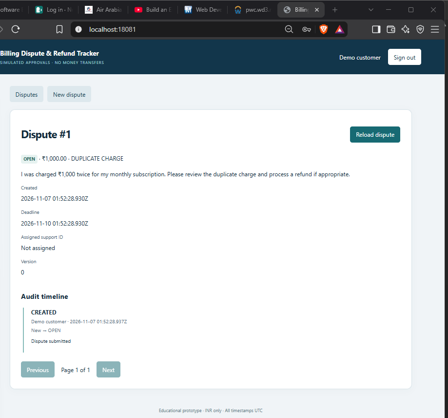
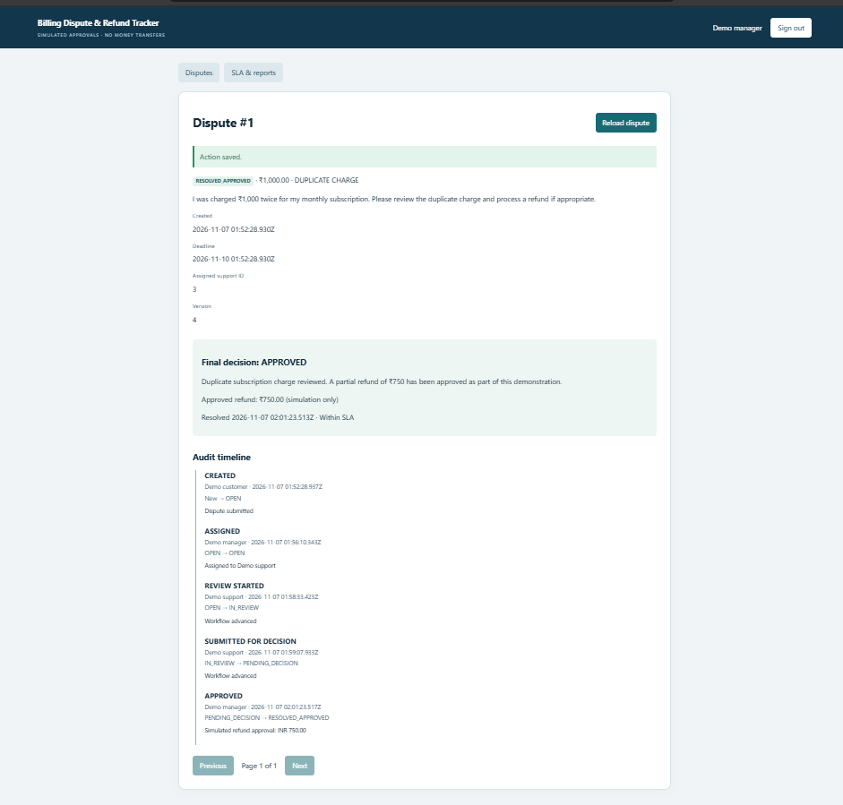
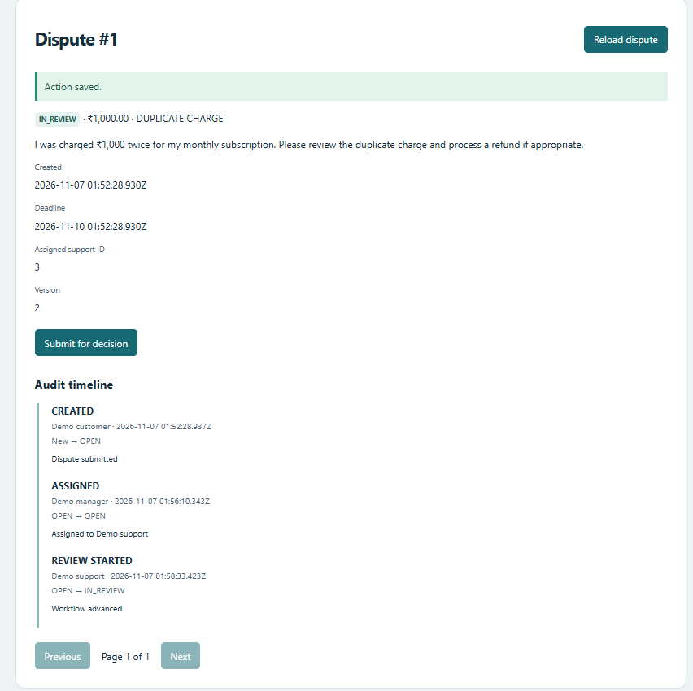
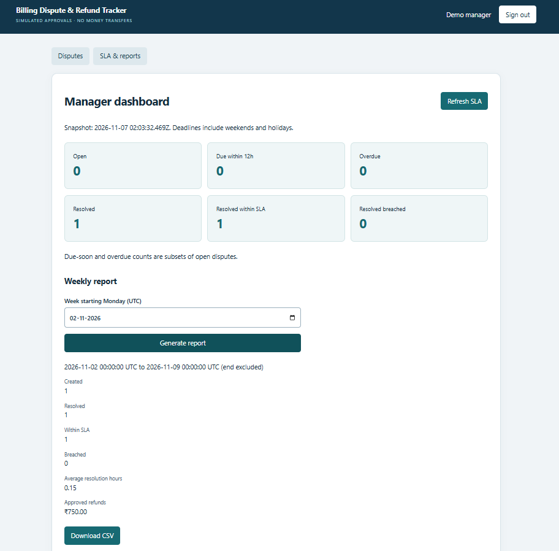
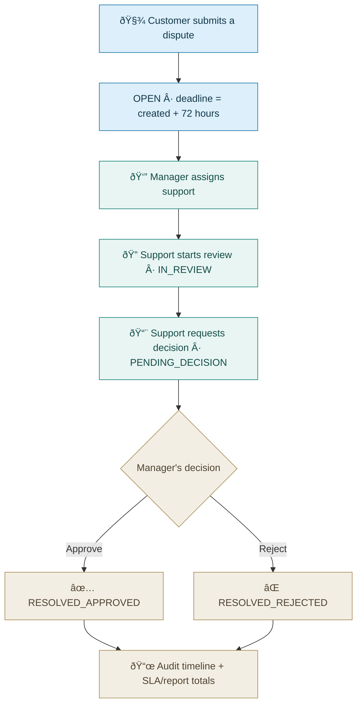
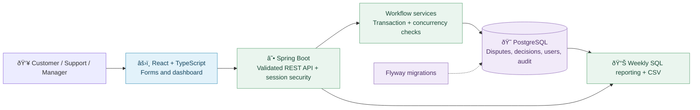
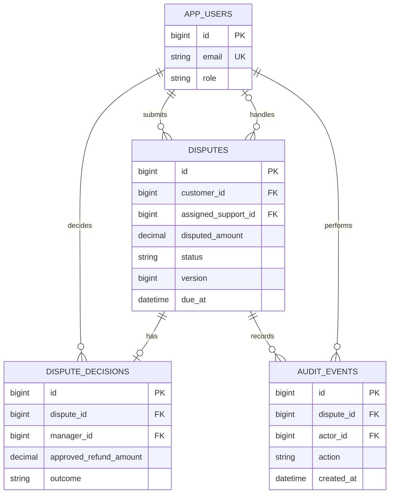

<div align="center">

# 🧾 Billing Dispute & Refund Tracker

**From a disputed charge to a fair, traceable decision.**

A full-stack software engineering project that helps customers report billing issues, gives support staff a clear workflow, and helps managers spot deadlines and record decisions.

**Java 21 · Spring Boot · PostgreSQL · React · TypeScript**


**[See the screenshots](#see-the-working-application) · [Run locally](#run-it-locally) · [Understand the workflow](#the-dispute-lifecycle) · [Read the user manual](docs/USER_MANUAL.md)**

<sub>Independent final-year educational project. Fictional accounts and charges. Refund approvals are simulated: no money is transferred.</sub>

</div>

---

## What problem does it solve?

Imagine you are charged twice for a monthly subscription. You contact support, but your complaint gets buried in messages. You do not know who is handling it, when you will receive an answer, or why a refund was approved or rejected. The manager also struggles to see which complaints are about to miss their deadlines. This application keeps the dispute, the responsible people, the deadline, the final explanation, and a time-stamped history in one place.

> **What it proves:** an explainable full-stack implementation of business rules, access control, database transactions, testing and reporting. **What it does not prove:** measured improvements in a real telecom company or real refund processing.

## See the working application

These are **real screenshots from a locally running Windows/Docker demonstration on 7 November 2026**, shared during the build and verification. The example dispute is fictional and uses INR 1,000 with a simulated INR 750 refund.

| Customer creates a dispute | Manager reviews the completed case |
|:--:|:--:|
| <a href="docs/screenshots/03-customer-dispute-detail.png"></a> | <a href="docs/screenshots/11-resolved-and-audit.png"></a> |
| **Customer view** — amount, deadline and current status | **Final decision** — outcome, explanation and audit history |

| Support moves the case forward | Manager tracks deadlines and reports |
|:--:|:--:|
| <a href="docs/screenshots/08-support-in-review.png"></a> | <a href="docs/screenshots/13-weekly-report.png"></a> |
| **Support workflow** — assigned review with traceability | **Weekly report** — resolution time, SLA counts and refund totals |

**[View all 13 step-by-step application screenshots and the full verification gallery](docs/SCREENSHOT_GALLERY.md)**. The gallery also includes screenshots of the Windows Docker build, Java tests, Playwright tests, dependency fixes and Git initialization. No manual screenshot saving is needed; they are already bundled with this documentation upgrade.

## Six features, with a business purpose

| Feature | What a nontechnical user sees | Why an engineer cares |
|---|---|---|
| 📝 **Dispute submission** | A customer reports an incorrect charge and follows its status. | Forms, validation, REST APIs, role-scoped SQL data. |
| 👥 **Assignment and support queue** | A manager gives a case to a support employee. | Ownership checks, filtering and pagination. |
| ✅ **Controlled final decision** | A manager approves or rejects a simulated refund with an explanation. | Transactions, state transitions, data integrity. |
| ⏰ **72-hour deadline tracking** | The dashboard shows open, due-soon, overdue and resolved cases. | Explicit UTC rules and boundary tests. |
| 🧾 **Audit timeline** | Every action shows who did it and when. | Debugging, traceability and atomic writes. |
| 📊 **Weekly reporting** | Managers review SLA results and download a CSV. | SQL aggregates, safe exports and documentation. |

## Who does what?

| Person | Can do | Cannot do |
|---|---|---|
| **Customer** | Submit disputes; see only their own cases and decisions. | Assign cases or approve refunds. |
| **Support agent** | See assigned cases; start review; submit for a manager's decision. | Approve a refund or read unrelated customers' cases. |
| **Manager** | See cases; assign support; approve/reject; see reports. | Change a completed final decision. |

## The dispute lifecycle



**Important:** A refund is an approval record only. The system never contacts a payment gateway. The status must advance in order; users cannot jump straight from OPEN to APPROVED. [Full rules](docs/ARCHITECTURE.md#status-transitions-and-data-integrity).

## Architecture at a glance



This is a **modular monolith**: one backend and one database, with a small React user interface. There is no Kafka, Kubernetes, AI or external payment service. For this project, that keeps the code understandable and makes changes easier to test.

[Architecture, workflow and sequence diagrams](docs/ARCHITECTURE.md) · [Database schema and indexes](docs/DATABASE_DESIGN.md) · [API documentation](docs/API.md)

## Tech stack, grouped by purpose

| Layer | Tools | Why used |
|---|---|---|
| **Frontend** | React 19, TypeScript, HTML5, CSS3, Vite | Accessible forms and role-specific pages. |
| **Backend** | Java 21, Spring Boot 3.5, Spring Security, Spring Data JPA, Bean Validation | Business rules, authentication and transactional APIs. |
| **Data** | PostgreSQL 16, Flyway, SQL, `BigDecimal` | Durable records, schema migrations and money-safe calculations. |
| **Backend tests** | JUnit 5, Spring Boot Test, PostgreSQL integration tests, JaCoCo | Validate decisions, permissions, rollback and coverage. |
| **Frontend & browser tests** | React Testing Library, Vitest, Playwright | Verify forms, navigation and complete workflows. |
| **Development & delivery** | Git, GitHub Actions, Maven, npm, Docker Compose | Version control, repeatable builds and local deployment. |
| **Documentation** | Markdown, OpenAPI/Swagger UI, Mermaid | Explain APIs, workflows, setup and troubleshooting. |

**Dependency note:** the first ZIP contained Vite 7.1.12 and Vitest 3.2.4. On **7 November 2026**, the local frontend was upgraded to **Vite 7.3.7 and Vitest 4.1.12**; that installation reported **0 npm vulnerabilities** and subsequently passed its build and eight component tests. This README upgrade does **not** replace your locally updated `frontend/package.json` or lockfile.

## Database: four key tables



A **unique decision per dispute** and **optimistic locking** (`@Version`) help prevent two managers from successfully recording conflicting final decisions. The final status, decision and audit write commit together. [Read the concurrency explanation](docs/ARCHITECTURE.md#how-two-managers-are-handled).

## Run it locally

### Start with Docker (recommended)

Prerequisite: Docker Desktop running with Linux containers. For the original project files, open **PowerShell at the repository root** and run:

```powershell
if (-not (Test-Path .env)) { Copy-Item .env.example .env }
# These host ports avoid conflicts with other local projects (for example EventPulse-SRE).
(Get-Content .env) -replace '^DB_PORT=.*$', 'DB_PORT=55433' -replace '^APP_PORT=.*$', 'APP_PORT=18081' | Set-Content .env
docker compose up --build -d --wait --wait-timeout 240
docker compose ps
Start-Process http://localhost:18081
```

Expected: the `app` and `db` services both show **healthy**. Your Windows demonstration succeeded with **application port 18081** and **database host port 55433**. The normal `.env.example` defaults may use 8080/5432; change those if the ports are free. **Never run `docker compose down -v` casually: it deletes the project's database volume.**

Linux/macOS shell:

```sh
cp -n .env.example .env  # only if not already present
# Edit APP_PORT and DB_PORT in .env if another project occupies them.
docker compose up --build -d --wait --wait-timeout 240
# Open http://localhost:8080, or your chosen APP_PORT.
```

### Local development tools

Java 21 JDK, Maven 3.9+, Node.js compatible with the pinned frontend packages and npm are needed if you run tests outside Docker. The included `scripts/setup.ps1` and `scripts/setup.sh` provide project setup instructions. [Windows troubleshooting](docs/TROUBLESHOOTING.md).

### Local demonstration accounts

| Role | Email | Password |
|---|---|---|
| Customer | `customer@demo.local` | `DemoPass123!` |
| Support | `support@demo.local` | `DemoPass123!` |
| Manager | `manager@demo.local` | `DemoPass123!` |

Accounts are seeded in the **local demonstration profile only**. These credentials must never be used for public hosting, and the project is not a production payment system.

## Tests and verified evidence

| Check | Evidence available | Status |
|---|---|---|
| Spring Boot / Maven build | Windows Maven `BUILD SUCCESS` screenshot | **Passed locally** |
| Java unit tests | Archived JUnit report: 37 | **Passed in archived run** |
| PostgreSQL integration tests | Windows Maven output: 30 tests, zero failures/errors/skips | **Passed locally** |
| React TypeScript + Vite build | Windows build after dependency update | **Passed locally** |
| React component tests | Windows Vitest 4.1.12: 8/8 | **Passed locally** |
| Playwright browser/API suite | Windows Chromium: 5/5 | **Passed locally** |
| Backend JaCoCo **line** coverage | Archived report: **406/420 = 96.67%** | **Recorded in original run** |
| Docker Compose deployment | Windows `app` and `db` healthy | **Passed locally** |
| Hosted GitHub Actions | Build and verify workflow passed on 7 November 2026 | **Passed** |

The **80 test cases** (37 + 30 + 8 + 5) reflect the archived and Windows evidence described above, not one single fresh command. The 96.67% figure is **line coverage**, not branch, instruction or production-quality certification. Tests use synthetic data. [Screenshots and exact context](docs/LOCAL_VERIFICATION.md).

To rerun the Java checks without Testcontainers auto-discovery on your Windows setup, use a **disposable separate** PostgreSQL test database (details in [troubleshooting](docs/TROUBLESHOOTING.md#testcontainers-cannot-find-docker-on-windows)). Do not run destructive integration tests against your app DB on port `55433`.

To rerun the frontend tests:

```powershell
Set-Location frontend
npm ci
npm run build
npm test
Set-Location ..
```

To rerun Playwright against an already running demo app:

```powershell
Set-Location e2e
npm ci
npx playwright install chromium
$env:BASE_URL = 'http://127.0.0.1:18081'
npm test
Set-Location ..
```

**Playwright tests create synthetic disputes.** They may change demonstration dashboard totals; they do not need your Dispute #1 to be deleted. To create fresh marketing screenshots in a later run, see [screenshot automation](docs/SCREENSHOT_GALLERY.md#regenerate-the-app-screenshots).

## Selected REST APIs

| Method and path | Purpose |
|---|---|
| `POST /api/disputes` | Submit a billing dispute. |
| `GET /api/disputes` | List permitted disputes with pagination. |
| `POST /api/disputes/{id}/assign` | Manager assigns support. |
| `POST /api/disputes/{id}/start-review` | Support begins review. |
| `POST /api/disputes/{id}/submit-for-decision` | Support sends case to manager. |
| `POST /api/disputes/{id}/decision` | Manager records final simulated decision. |
| `GET /api/disputes/{id}/audit` | Read committed history. |
| `GET /api/sla/summary` | Manager's SLA dashboard. |
| `GET /api/reports/weekly.csv` | Manager's downloadable report. |

OpenAPI/Swagger UI is available in the local application. [Complete endpoint and permission guide](docs/API.md).

## Repository layout

```text
billing-dispute-refund-tracker/
├── backend/                   Java 21 Spring Boot, Flyway, JUnit
├── frontend/                  React, TypeScript, Vite, Vitest
├── e2e/                       Playwright end-to-end scenarios
├── scripts/                   Windows and Linux setup/verification
├── docs/                      Architecture, API, manual, research, screenshots
│   ├── screenshots/           Working application gallery
│   └── evidence/chat/         Archived troubleshooting/testing screenshots
├── evaluation/                Archived reproducible test evidence
├── .github/workflows/ci.yml   GitHub Actions workflow definition
├── compose.yaml               App + PostgreSQL local services
├── Dockerfile                 Multi-stage application build
└── README.md                  You are here
```

## Documentation for different readers

| Reader | Start here |
|---|---|
| First-time user | [Plain-language user manual](docs/USER_MANUAL.md) |
| Recruiter or reviewer | [Screenshots](docs/SCREENSHOT_GALLERY.md) · [Three-minute demo](docs/DEMO_SCRIPT.md) |
| Developer | [Architecture](docs/ARCHITECTURE.md) · [API contract](docs/API.md) · [Database design](docs/DATABASE_DESIGN.md) |
| Student rebuilding it | [Ten-step build guide](docs/BUILD_STEP_BY_STEP.md) · [Git contribution workflow](docs/DEVELOPMENT_WORKFLOW.md) |
| Troubleshooting | [Windows and Docker troubleshooting](docs/TROUBLESHOOTING.md) |
| Testing reviewer | [Local verification record](docs/LOCAL_VERIFICATION.md) · [Original test report](docs/TEST_RESULTS.md) |
| Academic review | [Research and standards rationale](docs/RESEARCH_GAP.md) |

## Scope and limitations

- All accounts and charges are fictional; **no actual refunds or financial transfers**.
- No telecom billing provider, bank, payment gateway, SMS or AI integration.
- The audit log is append-oriented through application code, **not tamper-proof against a database administrator**.
- The fixed 72-hour SLA includes weekends and holidays. It is a project rule, not a telecom provider commitment.
- No live customer traffic, production load measurements or measured business improvement is claimed.
- A successful local Docker build is not evidence of a successful GitHub-hosted CI run.
- Security is appropriate to an educational local demo, not a production security certification.

## Open source and acknowledgements

Built as an independent final-year software engineering portfolio project. Source files and documentation are covered by the repository's [LICENSE](LICENSE). Project decisions, build steps and limitations are documented so another developer can understand or reproduce the implementation.

