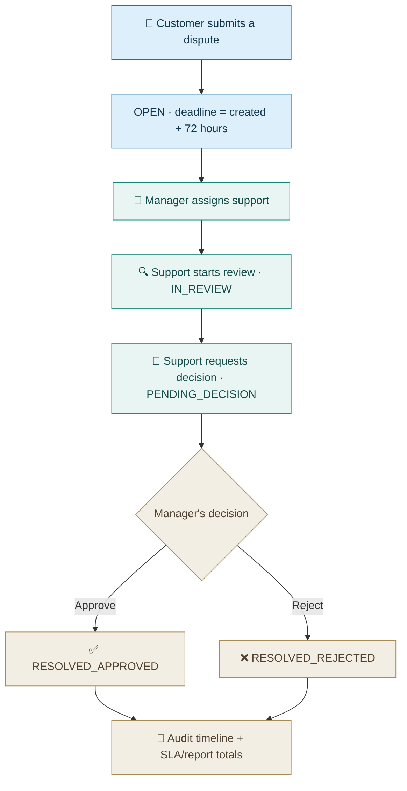
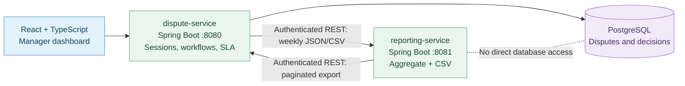
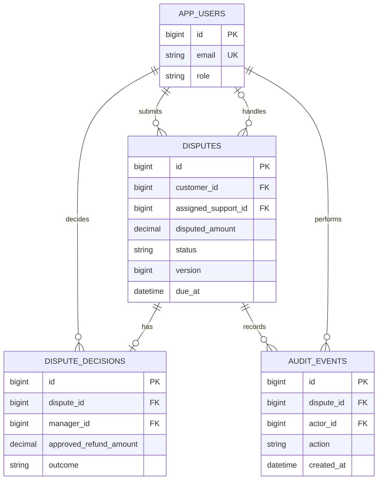

<div align="center">

# 🧾 Billing Dispute & Refund Tracker

**From a disputed charge to a fair, traceable decision.**

A full-stack software engineering project that helps customers report billing issues, gives support staff a clear workflow, and helps managers spot deadlines and record decisions.

**Java 21 · Spring Boot · PostgreSQL · React · TypeScript**


**[See the screenshots](#see-the-working-application) · [Run locally](#run-it-locally) · [Understand the workflow](#the-dispute-lifecycle) · [Read the user manual](docs/USER_MANUAL.md)**

<sub>Independent final-year educational project. Fictional accounts and charges. Refund approvals are simulated: no money is transferred.</sub>

</div>

---

## What problem does it solve?

Imagine you are charged twice for a monthly subscription. You contact support, but your complaint gets buried in messages. You do not know who is handling it, when you will receive an answer, or why a refund was approved or rejected. The manager also struggles to see which complaints are about to miss their deadlines. This application keeps the dispute, the responsible people, the deadline, the final explanation, and a time-stamped history in one place.

> **What it proves:** an explainable full-stack implementation of business rules, access control, database transactions, testing and reporting. **What it does not prove:** measured improvements in a real telecom company or real refund processing.

## See the working application

These are **historical screenshots of the original single-service build from a locally running Windows/Docker demonstration on 7 November 2026**, shared during the build and verification. The example dispute is fictional and uses INR 1,000 with a simulated INR 750 refund.

| Customer creates a dispute | Manager reviews the completed case |
|:--:|:--:|
| <a href="docs/screenshots/03-customer-dispute-detail.png"></a> | <a href="docs/screenshots/11-resolved-and-audit.png"></a> |
| **Customer view** — amount, deadline and current status | **Final decision** — outcome, explanation and audit history |

| Support moves the case forward | Manager tracks deadlines and reports |
|:--:|:--:|
| <a href="docs/screenshots/08-support-in-review.png"></a> | <a href="docs/screenshots/13-weekly-report.png"></a> |
| **Support workflow** — assigned review with traceability | **Weekly report** — resolution time, SLA counts and refund totals |

**[View all 13 step-by-step application screenshots and the full verification gallery](docs/SCREENSHOT_GALLERY.md)**. The gallery also includes screenshots of the Windows Docker build, Java tests, Playwright tests, dependency fixes and Git initialization. No manual screenshot saving is needed; they are already bundled with this documentation upgrade.

## Six features, with a business purpose

| Feature | What a nontechnical user sees | Why an engineer cares |
|---|---|---|
| 📝 **Dispute submission** | A customer reports an incorrect charge and follows its status. | Forms, validation, REST APIs, role-scoped SQL data. |
| 👥 **Assignment and support queue** | A manager gives a case to a support employee. | Ownership checks, filtering and pagination. |
| ✅ **Controlled final decision** | A manager approves or rejects a simulated refund with an explanation. | Transactions, state transitions, data integrity. |
| ⏰ **72-hour deadline tracking** | The dashboard shows open, due-soon, overdue and resolved cases. | Explicit UTC rules and boundary tests. |
| 🧾 **Audit timeline** | Every action shows who did it and when. | Debugging, traceability and atomic writes. |
| 📊 **Weekly reporting** | Managers review SLA results and download a CSV. | SQL aggregates, safe exports and documentation. |

## Who does what?

| Person | Can do | Cannot do |
|---|---|---|
| **Customer** | Submit disputes; see only their own cases and decisions. | Assign cases or approve refunds. |
| **Support agent** | See assigned cases; start review; submit for a manager's decision. | Approve a refund or read unrelated customers' cases. |
| **Manager** | See cases; assign support; approve/reject; see reports. | Change a completed final decision. |

## The dispute lifecycle



**Important:** A refund is an approval record only. The system never contacts a payment gateway. The status must advance in order; users cannot jump straight from OPEN to APPROVED. [Full rules](docs/ARCHITECTURE.md#status-transitions-and-data-integrity).

## Architecture at a glance



**Two independently buildable Spring Boot services:** dispute-service owns PostgreSQL and all workflow changes; reporting-service calculates weekly aggregates from a versioned, authenticated REST export only. The browser's existing manager reporting routes are unchanged. There is no service discovery, broker, Kubernetes or shared reporting database.

[Two-service architecture and security trade-offs](docs/MICROSERVICES.md) · [Original database schema](docs/DATABASE_DESIGN.md) · [Endpoint reference](docs/API.md)

> **Verified two-service release — 7 November 2026:** Both Java 21/Spring Boot services built independently. The three-container Docker Compose stack was healthy; authenticated inter-service REST, manager weekly JSON/CSV, and regression tests passed locally. GitHub Actions passed on the feature branch and on `main` after PR #1 was merged. See [measured test results](#tests-and-verified-evidence). The screenshots above remain labeled as historical captures of the original single-service UI.

## Tech stack, grouped by purpose

| Layer | Tools | Why used |
|---|---|---|
| **Frontend** | React 19, TypeScript, HTML5, CSS3, Vite | Accessible forms and role-specific pages. |
| **Backends (two)** | Java 21, Spring Boot 3.5, REST, Spring Security (dispute service only) | Separate builds/deployments; shared-key internal REST and manager session auth. |
| **Data** | PostgreSQL 16, Flyway, SQL, `BigDecimal` | Access restricted to dispute-service; report service aggregates REST records. |
| **Backend tests** | JUnit 5, Spring Boot Test, PostgreSQL integration tests, JaCoCo | Validate decisions, permissions, rollback and coverage. |
| **Frontend & browser tests** | React Testing Library, Vitest, Playwright | Verify forms, navigation and complete workflows. |
| **Development & delivery** | Git, GitHub Actions, Maven, npm, Docker Compose | Version control, repeatable builds and local deployment. |
| **Documentation** | Markdown, OpenAPI/Swagger UI, Mermaid | Explain APIs, workflows, setup and troubleshooting. |

**Frontend verification:** The merged project was tested locally with Vite 7.3.7 and Vitest 4.1.12: 8/8 component tests and the production build passed. Dependency audit results are time-specific; rerun `npm audit` when packages change.

## Database: four key tables



A **unique decision per dispute** and **optimistic locking** (`@Version`) help prevent two managers from successfully recording conflicting final decisions. The final status, decision and audit write commit together. [Read the concurrency explanation](docs/ARCHITECTURE.md#how-two-managers-are-handled).

## Run it locally

### Start with Docker (recommended)

Prerequisite: Docker Desktop running with Linux containers. Open **PowerShell at the repository root** and run:

```powershell
# Creates/updates local .env with an untracked shared service key.
powershell.exe -NoProfile -ExecutionPolicy Bypass -File .\scripts\setup.ps1
Start-Process http://localhost:18081
python scripts/smoke-two-services.py
```

Expected: `db`, `dispute-service` and `reporting-service` all show **healthy**. Your Windows demonstration succeeded with **application port 18081** and **database host port 55433**. The included defaults are app 18081, report 18082 and database 55433; edit `.env` if already in use. **Never run `docker compose down -v` casually: it deletes the project's database volume.**

Linux/macOS shell:

```sh
cp -n .env.example .env  # only if not already present
# Edit APP_PORT and DB_PORT in .env if another project occupies them.
./scripts/setup.sh
# Open http://localhost:18081, or APP_PORT from .env.
```

### Local development tools

Java 21 JDK, Maven 3.9+, Node.js compatible with the pinned frontend packages and npm are needed if you run tests outside Docker. The included `scripts/setup.ps1` and `scripts/setup.sh` provide project setup instructions. [Windows troubleshooting](docs/TROUBLESHOOTING.md).

### Local demonstration accounts

| Role | Email | Password |
|---|---|---|
| Customer | `customer@demo.local` | `DemoPass123!` |
| Support | `support@demo.local` | `DemoPass123!` |
| Manager | `manager@demo.local` | `DemoPass123!` |

Accounts are seeded in the **local demonstration profile only**. These credentials must never be used for public hosting, and the project is not a production payment system.

## Tests and verified evidence

**Verified two-service build — Windows, 7 November 2026.** The counts below come from separate completed local test runs and their Maven/JUnit/JaCoCo reports, not from one invented all-in-one run. All tests listed here passed with zero reported failures, errors or skips.

| Check | Measured result | Verification |
|---|---|---|
| **dispute-service** Maven/JUnit/PostgreSQL | **71 tests passed**, including **32 PostgreSQL integration cases** | Local `mvn clean verify` succeeded |
| **reporting-service** Maven/JUnit/REST client | **10 tests passed** (1 controller, 4 REST-client, 5 reporting-logic) | Independent `mvn clean verify` succeeded |
| React component tests | **8 tests passed** | Vitest 4.1.12 |
| Chromium browser/API suite | **5 tests passed** | Playwright regression run, 25.3 seconds |
| **Total tested locally** | **94 passed** (71 + 10 + 8 + 5) | Separate verification commands |
| dispute-service **JaCoCo line coverage** | **415/455 = 91.21%** | Local JaCoCo XML and coverage-summary script |
| reporting-service **JaCoCo line coverage** | **86/111 = 77.48%** | Local JaCoCo XML and coverage-summary script |
| Frontend TypeScript and production build | **Passed** | `npm run build` |
| Docker Compose | **PostgreSQL + dispute-service + reporting-service healthy** | Windows local stack; no standalone startup-time measurement claimed |
| Inter-service REST smoke | **Passed** | Both health endpoints, denied unauthenticated internal requests, manager weekly JSON and CSV |
| GitHub Actions on feature branch | **Passed — 3m 19s** | [PR #1 workflow](https://github.com/yusufthecoder474/billing-dispute-refund-tracker/actions/runs/42349345544) |
| GitHub Actions on `main` | **Passed — 3m 34s** | [Merged main workflow](https://github.com/yusufthecoder474/billing-dispute-refund-tracker/actions/runs/42349763861) |

**Original single-service baseline, retained for comparison only:** the archived package recorded 37 unit, 30 integration, 8 React and 5 browser/API tests (80 total), plus **406/420 = 96.67% backend JaCoCo line coverage**. Those numbers do **not** describe the updated architecture. Current coverage is per service; it is not branch coverage or a production performance claim. All charges and refunds are simulated.

The Compose startup time was not separately captured in the local screenshots. The CI workflow measures Compose start-to-healthy time in its `two-service-verification` artifact (`ci-metrics/startup.txt`), but no value is asserted here without inspecting that artifact. See [Windows verification details](docs/LOCAL_VERIFICATION.md) and [service design](docs/MICROSERVICES.md).

To rerun the Java checks without Testcontainers auto-discovery on your Windows setup, use a **disposable separate** PostgreSQL test database (details in [troubleshooting](docs/TROUBLESHOOTING.md#testcontainers-cannot-find-docker-on-windows)). Do not run destructive integration tests against your app DB on port `55433`.

To rerun the frontend tests:

```powershell
Set-Location frontend
npm ci
npm run build
npm test
Set-Location ..
```

To rerun Playwright against an already running demo app:

```powershell
Set-Location e2e
npm ci
npx playwright install chromium
$env:BASE_URL = 'http://127.0.0.1:18081'
npm test
Set-Location ..
```

**Playwright tests create synthetic disputes.** They may change demonstration dashboard totals; they do not need your Dispute #1 to be deleted. To create fresh marketing screenshots in a later run, see [screenshot automation](docs/SCREENSHOT_GALLERY.md#regenerate-the-app-screenshots).

## Selected REST APIs

| Method and path | Purpose |
|---|---|
| `POST /api/disputes` | Submit a billing dispute. |
| `GET /api/disputes` | List permitted disputes with pagination. |
| `POST /api/disputes/{id}/assign` | Manager assigns support. |
| `POST /api/disputes/{id}/start-review` | Support begins review. |
| `POST /api/disputes/{id}/submit-for-decision` | Support sends case to manager. |
| `POST /api/disputes/{id}/decision` | Manager records final simulated decision. |
| `GET /api/disputes/{id}/audit` | Read committed history. |
| `GET /api/sla/summary` | Manager's SLA dashboard. |
| `GET /api/reports/weekly.csv` | Manager's downloadable report (proxied to reporting-service). |
| `GET /internal/v1/disputes/export` | Protected, paginated dispute-service export for reporting-service only. |
| `GET /internal/v1/reports/weekly` | Reporting-service internal JSON report; shared key required. |

OpenAPI/Swagger UI is available separately in both local applications. Internal endpoints require the shared key and are not browser-facing. [Complete endpoint and permission guide](docs/API.md).

## Repository layout

```text
billing-dispute-refund-tracker/
├── dispute-service/          Spring Boot app, database, migrations, JUnit
├── reporting-service/        Independent Spring Boot app, REST client, CSV, tests
├── frontend/                  React, TypeScript, Vite, Vitest
├── e2e/                       Playwright end-to-end scenarios
├── scripts/                   Windows and Linux setup/verification
├── docs/                      Architecture, API, manual, research, screenshots
│   ├── screenshots/           Working application gallery
│   └── evidence/chat/         Archived troubleshooting/testing screenshots
├── evaluation/                Archived reproducible test evidence
├── .github/workflows/ci.yml   GitHub Actions workflow definition
├── compose.yaml               PostgreSQL + two Spring Boot services
├── dispute-service/Dockerfile  Independently buildable dispute image
├── reporting-service/Dockerfile Independently buildable reporting image
└── README.md                  You are here
```

## Documentation for different readers

| Reader | Start here |
|---|---|
| First-time user | [Plain-language user manual](docs/USER_MANUAL.md) |
| Recruiter or reviewer | [Screenshots](docs/SCREENSHOT_GALLERY.md) · [Three-minute demo](docs/DEMO_SCRIPT.md) |
| Developer | [Architecture](docs/ARCHITECTURE.md) · [API contract](docs/API.md) · [Database design](docs/DATABASE_DESIGN.md) |
| Student rebuilding it | [Ten-step build guide](docs/BUILD_STEP_BY_STEP.md) · [Git contribution workflow](docs/DEVELOPMENT_WORKFLOW.md) |
| Troubleshooting | [Windows and Docker troubleshooting](docs/TROUBLESHOOTING.md) |
| Testing reviewer | [Local verification record](docs/LOCAL_VERIFICATION.md) · [Original test report](docs/TEST_RESULTS.md) |
| Academic review | [Research and standards rationale](docs/RESEARCH_GAP.md) |

## Scope and limitations

- All accounts and charges are fictional; **no actual refunds or financial transfers**.
- No telecom billing provider, bank, payment gateway, SMS or AI integration.
- The audit log is append-oriented through application code, **not tamper-proof against a database administrator**.
- The fixed 72-hour SLA includes weekends and holidays. It is a project rule, not a telecom provider commitment.
- No live customer traffic, production load measurements or measured business improvement is claimed.
- GitHub-hosted CI passed on both the feature branch and merged `main`; this is not a production deployment or security certification.
- Security is appropriate to an educational local demo, not a production security certification.

## Open source and acknowledgements

Built as an independent final-year software engineering portfolio project. Source files and documentation are covered by the repository's [LICENSE](LICENSE). Project decisions, build steps and limitations are documented so another developer can understand or reproduce the implementation.
