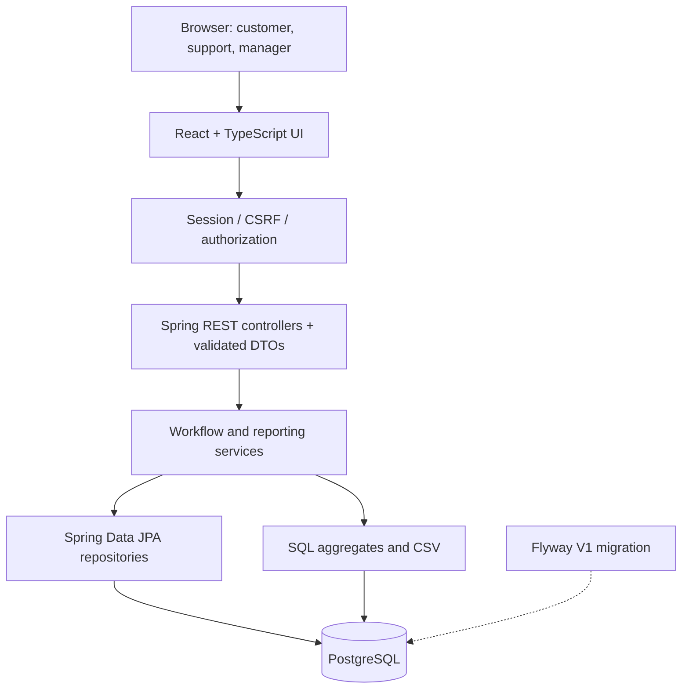
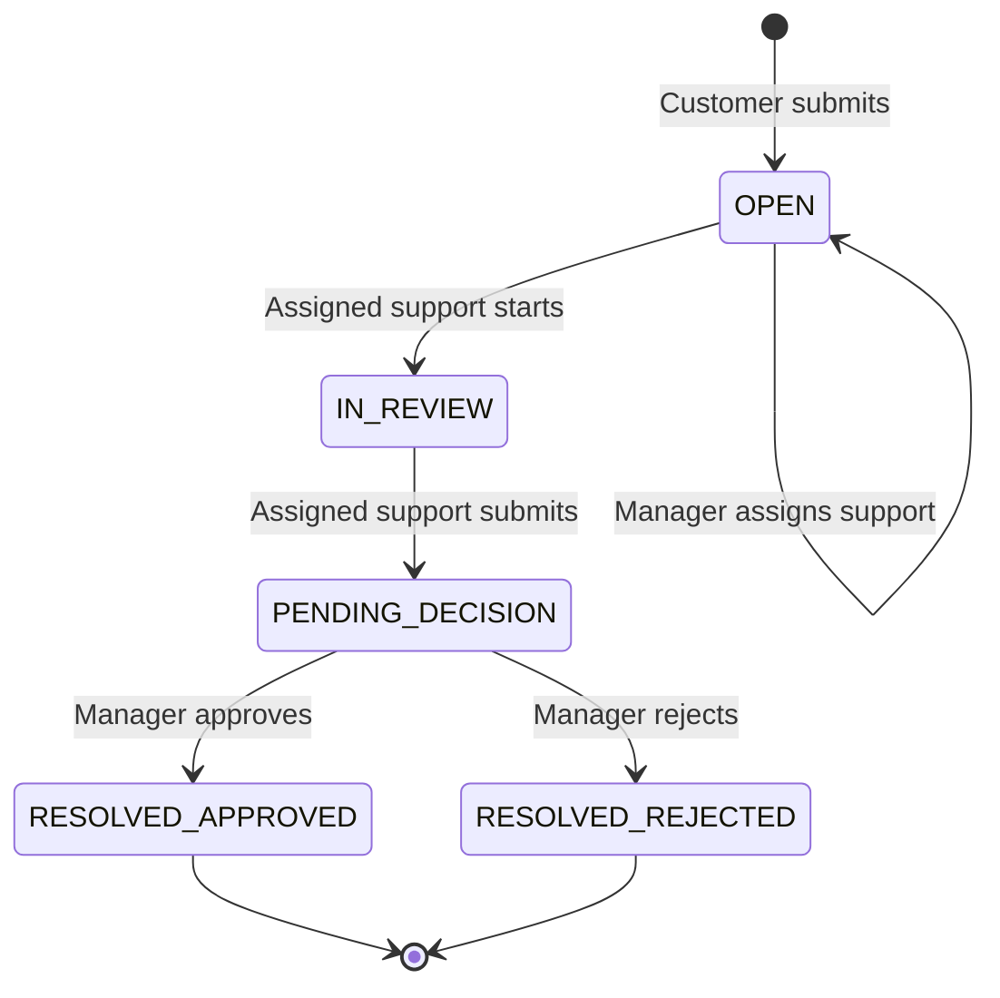
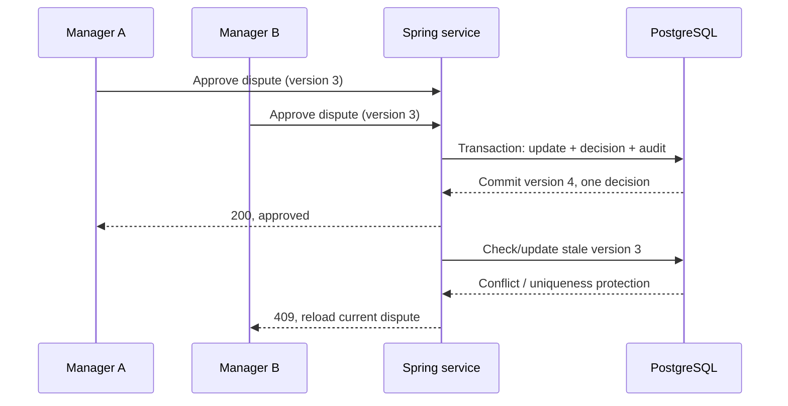
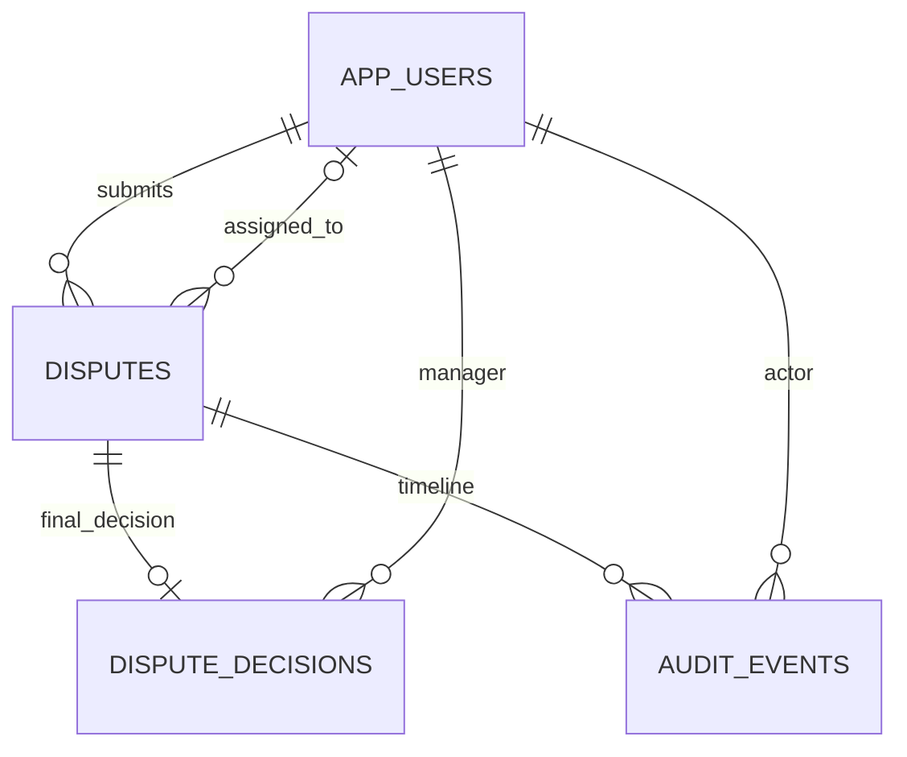

> **Two-service upgrade:** The original single-service notes below are historical where they refer to `backend/`, SQL reporting inside the app or the previous Compose service names. See [current two-service design](MICROSERVICES.md) for updated architecture, internal endpoints, deployment, auth, limitations and verification status. New two-service tests are not yet measured.

# Architecture and engineering decisions

[← README](../README.md) · [Database design](DATABASE_DESIGN.md) · [API contract](API.md) · [Test evidence](LOCAL_VERIFICATION.md)

## Why one backend?

A billing dispute is a modest business workflow with relational data and strong consistency rules. One Spring Boot application and PostgreSQL database can update a dispute, insert the final decision and append an audit event **in one database transaction**. Microservices or queues would make the example harder to understand without solving a demonstrated requirement.

### Components at a glance

| Component | Purpose | Example file |
|---|---|---|
| React frontend | Screens, forms, role-specific navigation, API calls | `frontend/src/App.tsx` |
| API controllers | HTTP endpoints and validated DTOs | `backend/.../controller/DisputeController.java` |
| Security | Session authentication, role checks, CSRF | `backend/.../security/SecurityConfig.java` |
| Business services | Transition rules, assignment, approval and audit | `backend/.../service/DisputeService.java` |
| Rules | Reusable validation, SLAs, CSV safety | `backend/.../service/Rules.java` |
| Persistence | Versioned entities, SQL and transactions | `backend/.../domain/`, `repository/` |
| Database | Enforces keys, check constraints and unique decisions | `V1__initial_schema.sql` |

`backend/.../` is shorthand for `backend/src/main/java/dev/billing/`.

## Status transitions and data integrity

Invalid transitions are rejected. Only the assigned agent can advance a case through support states; only a manager can record a final decision. Disputed and approved amounts use **Java `BigDecimal`** and SQL `NUMERIC(12,2)` instead of floating-point arithmetic. Approval may not exceed the disputed amount. The database also requires nonnegative approval amounts and limits a rejected amount to zero.

## How two managers are handled

Imagine two managers open the same pending case at almost the same time. Both see version **3**. One approves; the database commits the decision and updates the dispute to version **4**. The second request still holds version 3 and receives a conflict instead of creating a second final decision.

Protection comes from **JPA `@Version`**, a **unique `dispute_id`** on `dispute_decisions`, and **transactional writes**. The recorded two-request test observed one success and one HTTP 409. It does **not** demonstrate performance under thousands of concurrent requests.

### Atomic audit and rollback

The system writes a committed event for creation, assignment, review start, decision submission and final decision. If audit insertion fails inside a decision transaction, the final decision and status update must roll back too. An intentionally injected audit failure appears as a stack trace in the integration test logs; that check passed because the partial operation was rejected.

The application prevents updates/deletes through its audit repository API, but database administrators could still alter history. This is **not an immutable or cryptographically tamper-proof audit ledger**.

## The database schema

The four tables and indexes are defined in `backend/src/main/resources/db/migration/V1__initial_schema.sql`. There are separate indexes for customer history, assigned support queues, status/deadline filtering, weekly reports and audit history. Flyway creates the schema; Hibernate validates it rather than silently changing it at runtime.

## SLA and reporting definitions

- `due_at = created_at + 72 hours`, using UTC and including weekends/holidays.
- A case is **due soon** when still unresolved and its deadline falls within the next 12 hours.
- A case is **overdue** when unresolved and its deadline has passed.
- A resolved case is **within SLA** if the resolution timestamp is on or before its deadline.
- Weekly boundaries use Monday 00:00 UTC inclusive to the following Monday 00:00 UTC exclusive.
- CSV values are escaped/guarded against formula injection.

These are documented local project rules, not a telecom regulatory standard. Test fixtures cover boundaries and weekly aggregates.

## Security and boundaries

Spring Security enforces roles and scope server-side. Local demo accounts have BCrypt password hashes. Session-based browser authentication uses CSRF protection for state-changing requests. UI buttons are not authorization gates: the backend checks the authenticated actor.

The project remains an educational prototype; session/cookie deployment settings, secret handling, audit tamper resistance and financial integration would need further assessment before public production use. [Full limitations](SECURITY_LIMITATIONS.md).

## Testing map

| Layer | Checks |
|---|---|
| Unit | State and input rules, SLA calculations, money/CSV validation |
| Integration | PostgreSQL persistence, authentication, authorization, concurrency, rollback |
| UI component | Forms, validation, loading/error states, pagination, conflicts |
| Playwright | Customer, support, manager, report, role and CSRF checks |

The original project archive recorded 37 unit, 30 integration, 8 frontend and 5 Playwright tests. The Windows screenshots confirmed the integration/frontend/browser runs. [Verification caveats](LOCAL_VERIFICATION.md).
