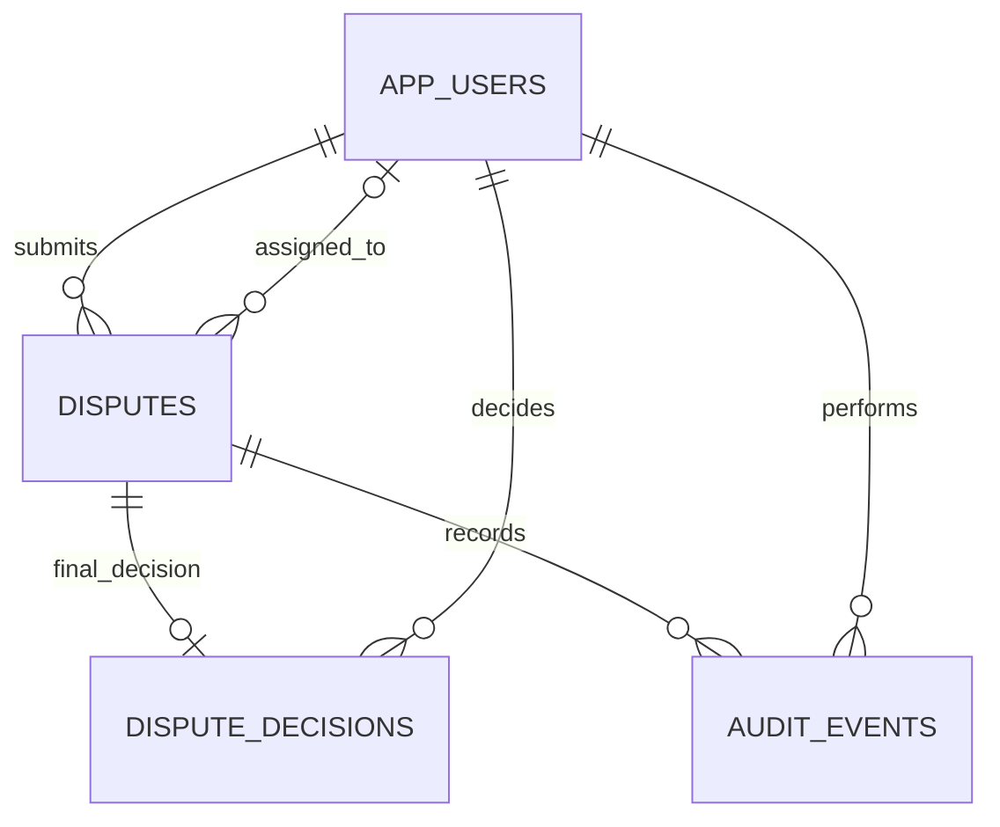

# Database design

Flyway V1 is authoritative. Hibernate runs `ddl-auto: validate`; it never creates or repairs tables. Monetary columns use NUMERIC(12,2), Java uses BigDecimal, and all dates are PostgreSQL TIMESTAMPTZ / Java Instant. Category, role, status and outcome values have database checks. IDs are generated BIGINT values.



| Table | Purpose and integrity |
|---|---|
| app_users | Unique email, BCrypt hash, display name and one validated role. Only local/test seeding. |
| disputes | Required customer, optional support, category, description, positive charge, fixed INR, status and immutable creation/deadline timestamps. Version protects updates. Resolved status and timestamp must agree. |
| dispute_decisions | Unique dispute FK; required manager, outcome, nonnegative amount and explanation. Rejection amount must be zero. Service additionally enforces amount ≤ charge. |
| audit_events | Required dispute, actor, action, next status, timestamp and detail; previous status nullable only for creation through application logic. No update/delete service. |

| Index | Reason |
|---|---|
| idx_customer_history(customer_id, created_at DESC) | Paginated customer history, without scanning other customers. |
| idx_support_queue(assigned_support_id, status, due_at) | Assigned support and filtered status/deadline queue. |
| idx_status_deadline(status, due_at) | Status-filtered deadline searches. |
| idx_created_report(created_at) | Half-open created-in-week counts. |
| idx_resolved_report(resolved_at), non-null only | Resolution-time weekly filtering while omitting unresolved rows. |
| idx_audit_timeline(dispute_id, created_at, id) | Stable chronological pagination, including timestamp ties. |

The unique constraint on dispute_decisions.dispute_id also creates an index for detail/report joins. Foreign keys do not prove role membership; service checks ensure customer/support/manager semantics. There are no delete endpoints or cascade-delete policies. Deadline = creation + 72 elapsed hours; all local/test timestamps are UTC. Set the database/session timezone to UTC for manual SQL inspection.

Inspect locally:

```sh
docker compose exec db psql -U billing -d billing -c "SELECT installed_rank, version, success FROM flyway_schema_history;"
docker compose exec db psql -U billing -d billing -c "SELECT id,status,version,created_at,due_at,resolved_at FROM disputes ORDER BY id;"
docker compose exec db psql -U billing -d billing -c "SELECT dispute_id,count(*) FROM dispute_decisions GROUP BY dispute_id HAVING count(*) > 1;"
```

The last query should return no rows. Add a new V2 migration for future changes; do not edit an already-applied V1. Real deployments should use separate migration and runtime database credentials; the local demo uses one account for clarity.
