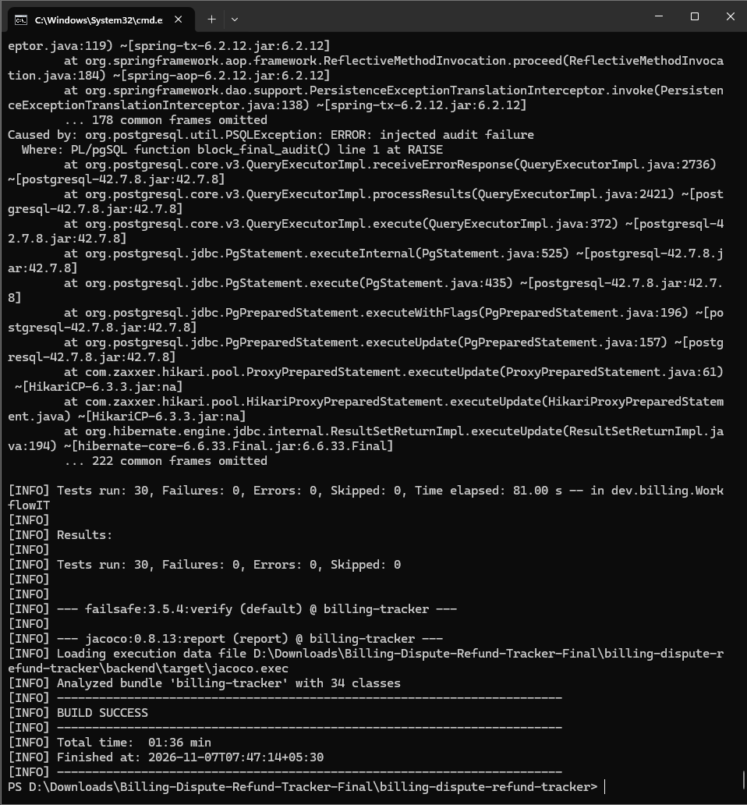
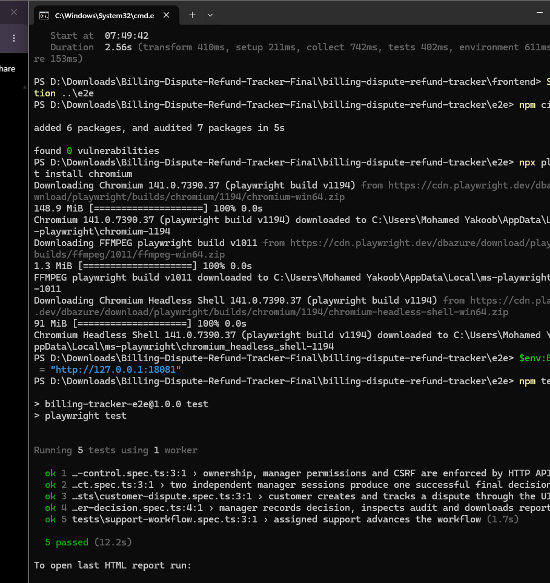
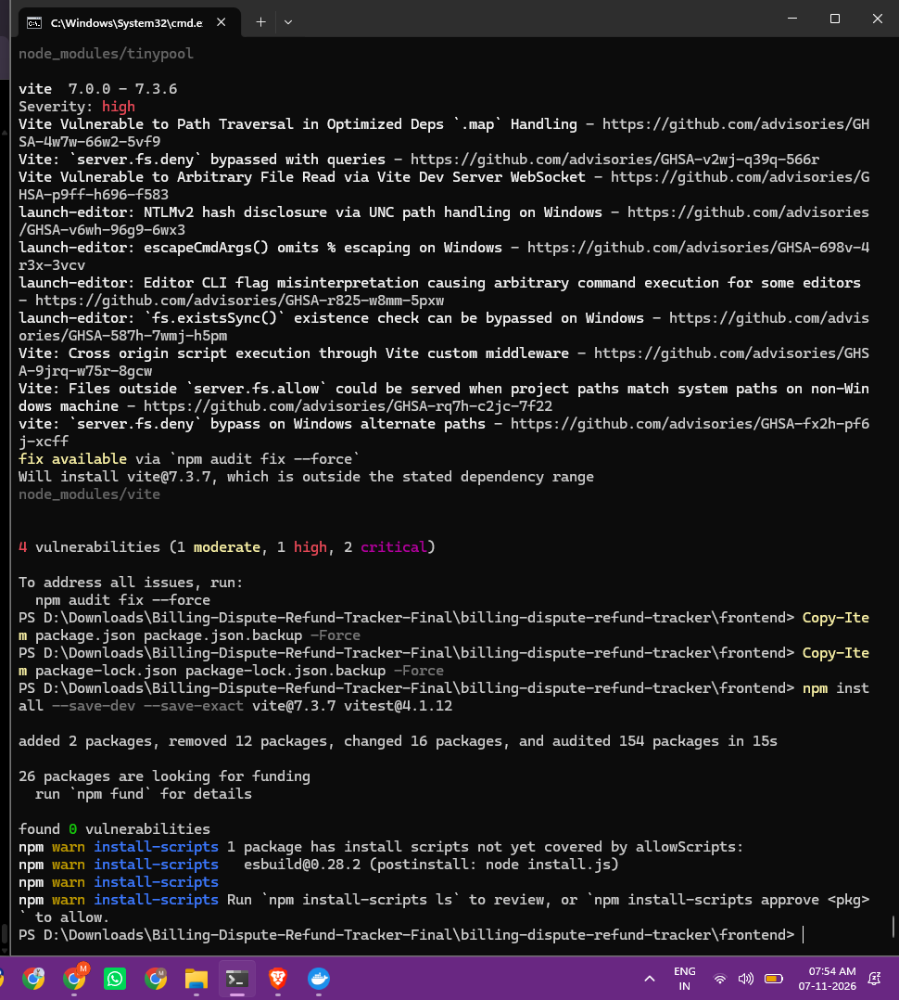
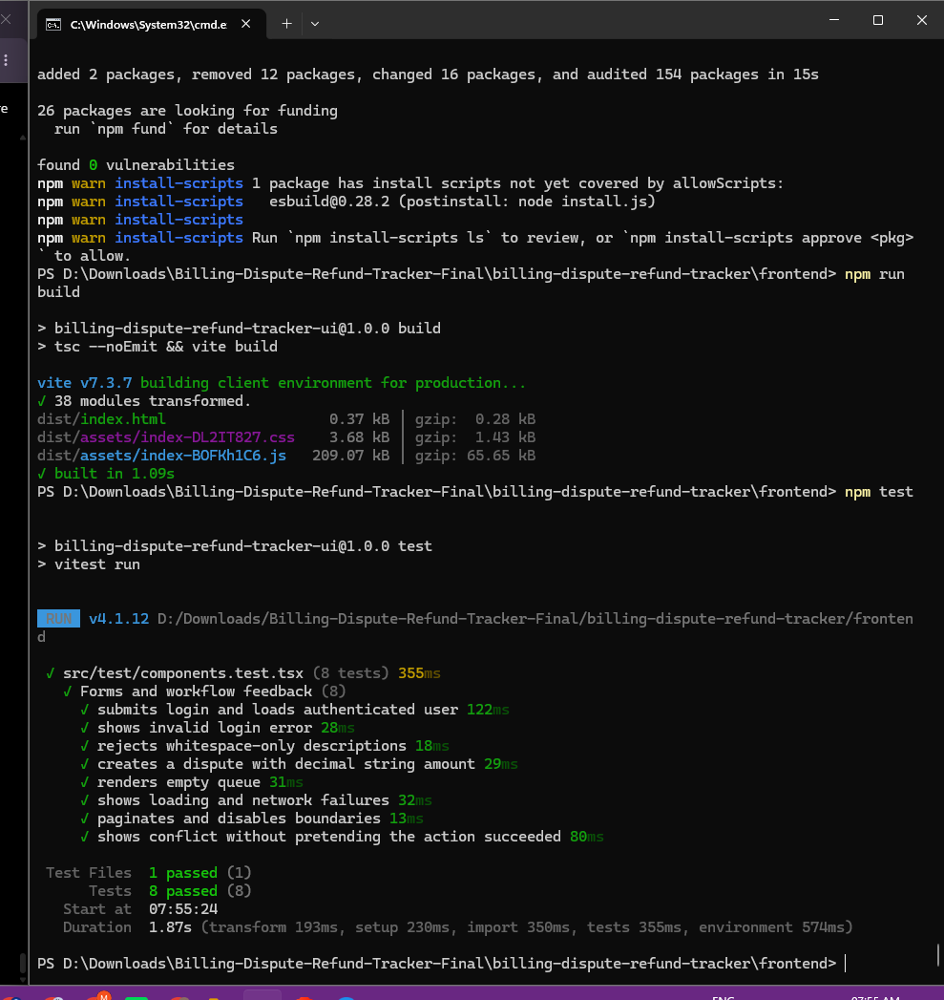

> **Two-service upgrade:** The original single-service notes below are historical where they refer to `backend/`, SQL reporting inside the app or the previous Compose service names. See [current two-service design](MICROSERVICES.md) for updated architecture, internal endpoints, deployment, auth, limitations and verification status. New two-service tests are not yet measured.

# Verification record — Windows, 7 November 2026

[← README](../README.md) · [Screenshot gallery](SCREENSHOT_GALLERY.md) · [Original archived test results](TEST_RESULTS.md)

The table below separates what the user **ran locally on Windows** from measurements recorded in the **original supplied ZIP**. These are reproducible student project checks, not production certifications.

| Area | Evidence and result | Status |
|---|---|---|
| Docker deployment | Both `app` and `db` containers healthy; app on `127.0.0.1:18081` and database host port `55433` | PASSED locally |
| Manual customer → manager demonstration | Dispute #1 created, assigned, reviewed, submitted, approved; five audit entries | PASSED locally |
| Manager SLA/weekly report | 1 created, 1 resolved, 1 within SLA, 0 breached, 0.15 hours average, INR 750 simulated refund | PASSED locally for this example |
| Maven build | `mvn -B -f backend/pom.xml clean verify` ended `BUILD SUCCESS` | PASSED locally |
| PostgreSQL integration | `WorkflowIT`: 30 run, 0 failures, 0 errors, 0 skipped | PASSED locally using disposable external PostgreSQL |
| Unit tests | Archived JUnit XML: 37 parameterized/unit invocations | PASSED in supplied archive; local Maven run succeeded but the unit-test count is not visible in the provided screenshot |
| TypeScript and Vite | `npm run build` succeeded after Vite 7.3.7 upgrade | PASSED locally |
| React components | Vitest 4.1.12: 8/8 | PASSED locally |
| Playwright browser/API | Chromium: 5/5, including access, workflow, manager and race paths | PASSED locally |
| Frontend security audit | npm install after targeted Vite/Vitest upgrade: 0 reported vulnerabilities | PASSED audit at that point in time; not a lifetime guarantee |
| Backend line coverage | Original JaCoCo XML: 406 of 420 lines, 96.67% | RECORDED in original archive; locally generated coverage report was not separately parsed here |
| GitHub-hosted Actions | Workflow file exists, but no completed remote run was shown | NOT VERIFIED |
| Optional screenshot regeneration script | Added in documentation package; not executed here | NOT VERIFIED |

**Total historically reported tests:** 37 + 30 + 8 + 5 = **80**. Local screenshots directly confirm 30 integration, 8 component and 5 browser/API tests, plus Maven `BUILD SUCCESS`; original XML confirms the 37 unit invocations. These are not one single coordinated 80-test run after the frontend dependency update.

## Evidence highlights

| Database and backend | Browser tests |
|:--:|:--:|
|  |  |

| Dependency update | Retested frontend |
|:--:|:--:|
|  |  |

[**Open the complete evidence gallery, including resolved setup errors**](SCREENSHOT_GALLERY.md#b-windows-setup-testing-and-git-evidence).

## Important distinctions

- On the first Maven attempt, Testcontainers could not locate a valid Docker environment. The workaround used a **separate PostgreSQL test container on port 55434** with `TEST_DB_URL`, `TEST_DB_USER`, and `TEST_DB_PASSWORD`. The final 30 PostgreSQL integration tests passed using that external database, not Testcontainers provisioning.
- The `injected audit failure` stack trace in Maven output was an intentional rollback test; the test suite still finished with zero failures/errors.
- Playwright test records are synthetic. Tests may create new cases when rerun.
- The revised frontend build is present in the user's **local working copy**, not in the original ZIP attached before the npm upgrade. This documentation package deliberately leaves frontend manifests and lockfiles untouched.
- A published GitHub repository and a green hosted workflow are future verification steps, not evidence of the new two-service build.

## Commands used after repairing the Windows environment

Backend (run from repository root):

```powershell
# Disposable PostgreSQL test database, separate from the application database.
docker run -d --name billing-it-postgres -e POSTGRES_DB=billing_it -e POSTGRES_USER=billing_it -e POSTGRES_PASSWORD=local-only-test-pw -p 127.0.0.1:55434:5432 postgres:16.4-alpine
$env:TEST_DB_URL = 'jdbc:postgresql://127.0.0.1:55434/billing_it'
$env:TEST_DB_USER = 'billing_it'
$env:TEST_DB_PASSWORD = 'local-only-test-pw'
mvn -B -f backend/pom.xml clean verify
```

If the disposable container already exists, **do not create it again**; start it with `docker start billing-it-postgres` and check `pg_isready`. Do not point the tests to port 55433: those integration tests reset tables.

Frontend and E2E:

```powershell
Set-Location frontend
npm ci
npm run build
npm test
Set-Location ..\e2e
npm ci
npx playwright install chromium
$env:BASE_URL = 'http://127.0.0.1:18081'
npm test
Set-Location ..
```

## Evidence limitations

The images came from the user's local screenshots, not tests executed again while preparing these documentation files. Only the depicted actions/results are asserted. The app is an educational local demo; no employee productivity, financial impact, real customer adoption or production-grade security claim is supported.
