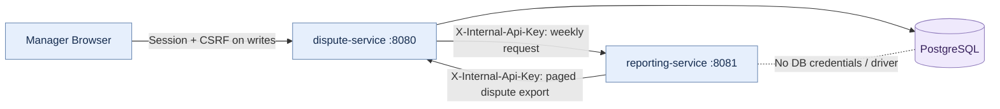

# Two-service reporting extraction

## What changed, and what did not

This is a small educational *two-service* system, not a production-scale distributed platform.

- **dispute-service** (Java 21/Spring Boot, port 8080 inside Docker) owns sign-in, role checks, dispute state transitions, the SLA dashboard, PostgreSQL, migrations, and the React static build. It still exposes the existing manager routes `/api/reports/weekly` and `/api/reports/weekly.csv`, but now calls reporting-service for their content.
- **reporting-service** (separate Java 21/Spring Boot/Maven build, port 8081 inside Docker) owns the weekly calculation and CSV serialization. It has **no DataSource, JDBC driver, or database privileges**.
- Reporting-service requests bounded pages from dispute-service over REST, using `/internal/v1/disputes/export?week=YYYY-MM-DD&cursor=0&limit=100`. No other data source is permitted for reporting-service.



### Why a two-way REST call?

The existing React manager UI assumes `/api/reports/weekly` on the same origin, with its current login cookie. Changing it would require exposing internal service credentials to the browser, which is unsafe. Instead, dispute-service retains the manager-only gateway route, sends an authenticated request to reporting-service, and forwards JSON/CSV back. Reporting-service obtains only minimal report inputs through the separate authenticated export REST API. That makes the deployment boundaries real without rebuilding the UI.

## Internal API contracts

| Endpoint | Owner | Authentication | Data |
|---|---|---|---|
| `GET /internal/v1/disputes/export?week=...&cursor=...&limit=100` | dispute-service | Shared `X-Internal-Api-Key` | `{items:[{id,createdAt,dueAt,resolvedAt,approvedRefundAmount}],nextCursor}` |
| `GET /internal/v1/reports/weekly?week=...` | reporting-service | Shared `X-Internal-Api-Key` | Aggregate `WeeklyReport` JSON |
| `GET /internal/v1/reports/weekly.csv?week=...` | reporting-service | Shared `X-Internal-Api-Key` | Aggregate CSV |
| `GET /api/reports/weekly?week=...` | dispute-service | Existing manager login | Same externally visible report JSON |
| `GET /api/reports/weekly.csv?week=...` | dispute-service | Existing manager login | CSV with attachment filename |

Week must be a Monday in UTC. The interval is `[week start, next Monday)`; a dispute qualifies for export if created **or** resolved in the week. Reporting counts both cohorts separately. Rows are sorted by increasing dispute ID with a cursor. No names, emails, customer messages, user IDs or credentials leave dispute-service in the reporting export.

**Data access:** SQL is contained in dispute-service's `ReportExportController`. Reporting-service uses the standard Java HTTP client, records and Java calculations. Schema migrations and the unique-decision/optimistic-locking guarantees remain exclusively in dispute-service.

## Security model and limitations

Both internal APIs require the same **random shared key**, supplied through local `.env` and container environment variables. The key must be at least 24 characters, is compared using `MessageDigest.isEqual`, and is never returned in API responses or printed by the test script. The real browser uses the existing Spring Security session and manager authorization. Compose binds both ports to loopback, and containers communicate on its private network.

This key is intentionally simple for a final-year demo. It is **not** per-service identity, rotation, mTLS, a production secret manager or a replacement for TLS. A leaked key allows access to internal reporting data. Use a private network, don't publish reporting-service, don't commit `.env`, and regenerate credentials if exposed. The reporting service does not have customer access to the database.

## Resilience and consistency

- Both Java HTTP clients use a **2-second connection timeout**, a **5-second request timeout** in the normal configuration and **at most one retry** for transport failures or HTTP 5xx. GET is idempotent, so this retry is safe at the API level.
- If reporting-service is unavailable, the existing manager report routes return a clear HTTP **503** instead of a misleading empty CSV. If dispute-service is unavailable, reporting-service returns **503**. Invalid upstream service credentials or malformed payloads produce **502**.
- The internal export uses keyset pagination, at most 100 rows per page. A report stops after 200 pages (20,000 rows) and fails explicitly, never returning partial results. This is a demo-scale limit, not a production benchmark.
- **No cross-service transaction or fixed database snapshot** exists. Concurrent changes may affect the cohort between pages. For reporting consistency at larger scale, use a snapshot token or a dedicated event-fed read model; neither is implemented here.
- The SLA dashboard (`/api/sla/summary`) still queries PostgreSQL in dispute-service because this split intentionally extracts *weekly reports only*.
- No external payments are performed. All data are fictional. Demo accounts and security policies are not production ready.

## Run locally

Prerequisites: Java 21, Maven 3.9+ for local JVM tests, Node 22 for UI, Docker Desktop for the Compose stack.

**Windows PowerShell (repository root):**

```powershell
Copy-Item .env.example .env  # skip if you already have .env
Add-Content .env ('INTERNAL_API_KEY=' + [guid]::NewGuid().ToString('N'))
docker compose up --remove-orphans --build -d --wait --wait-timeout 300
python scripts/smoke-two-services.py
```

For an existing `.env`, add a key only if one isn't already present. Or run `powershell.exe -ExecutionPolicy Bypass -File .\scripts\setup.ps1`, which handles this check. On Linux, `./scripts/setup.sh` generates the key using `openssl` when needed.

Open **http://localhost:18081** for the existing React app. `http://localhost:18082/api/health` checks reporting-service. Runtime OpenAPI is under `/v3/api-docs` and Swagger UI under `/swagger-ui/index.html` on each service in the demo Compose profile. **Never put the shared key in the browser or frontend source.**

For independent Maven builds:

```powershell
mvn -B -f dispute-service/pom.xml clean verify
mvn -B -f reporting-service/pom.xml clean verify
```

Each module produces its own JAR and JaCoCo report in its `target/` directory. For the entire local suite, run `powershell.exe -ExecutionPolicy Bypass -File .\scripts\verify.ps1` after starting Docker. Existing integration tests require Testcontainers or a dedicated disposable PostgreSQL database (`TEST_DB_URL`). They truncate test tables: never point `TEST_DB_URL` at your demo/production database.

### Tests and verification status

New tests: reporting aggregation edge cases, export REST contract with WireMock, invalid service credentials, bounded retry, unavailable upstream, existing frontend Playwright workflow, a Compose smoke that verifies both services through the manager route. The original backend tests are preserved, but the weekly fixture's report portion now tests the **proxy** using a mock; actual aggregation is tested in reporting-service.

**Verified 7 November 2026:** The upgraded system passed **94 local automated tests** across four suites (dispute-service 71, reporting-service 10, React 8, Playwright 5). JaCoCo **line coverage** was **415/455 (91.21%)** for dispute-service and **86/111 (77.48%)** for reporting-service. The three Compose containers were healthy, manager JSON/CSV reporting passed across authenticated REST, and both internal endpoints rejected unauthenticated requests. GitHub Actions passed on the feature branch (**3m 19s**) and merged `main` (**3m 34s**). The archived original single-service figures remain historical only.

CI saves test XML, JaCoCo CSV/XML, Docker logs and the measured `ci-metrics/startup.txt`. The full workflow runtime is on the GitHub Actions run page. Use `python3 scripts/coverage-summary.py` to print **actual measured** per-module test counts and JaCoCo line coverage after Maven completes.

## Trade-offs for interview

I extracted weekly reporting because it is a read-only feature with a clear contract and independent release boundary. The existing application still owns the authoritative dispute records, and I deliberately avoided a shared database. This gives direct experience with service-to-service authentication, HTTP failure handling, separate build/deployment and contract testing. The price is additional latency, two-way synchronous HTTP dependencies, duplicated DTO definitions, and no transactional snapshot across pages. This is not service discovery, Kafka, Kubernetes, autoscaling or a production distributed architecture.

**30-second interview explanation:** "My dispute tracker started as a Spring Boot monolith. I extracted weekly reporting into a separate Java 21 Spring Boot service, with its own Maven build and Docker image. The reporting service cannot connect to PostgreSQL; instead it retrieves paginated minimal records from the dispute service through a versioned REST endpoint protected by a shared API key. I kept the existing manager-only frontend API, added timeouts, one retry and a 503 error path, and wrote aggregation and HTTP contract tests. The trade-off is more network dependency and no cross-service snapshot."

**Resume bullets supported by the verified student project:**

- Built **two independently deployable Java 21/Spring Boot services**, verified by **94 passing local tests** and a green `main` CI run, by extracting weekly CSV reporting behind a versioned, authenticated REST contract.
- Preserved the React manager dashboard and reporting workflow, confirmed by a successful **three-container Compose smoke**, **5 passing Playwright tests**, and working weekly JSON/CSV, while keeping PostgreSQL accessible only to dispute-service.
- Tested service failures and HTTP contracts in reporting-service's **10 passing tests**; measured **77.48% reporting-service line coverage** and implemented bounded retry, timeouts and explicit 503 errors.

These are local/hosted student-project measurements, not claims of commercial production traffic. The two-way synchronous REST flow, lack of cross-service snapshot, and educational key authentication remain intentional trade-offs.
