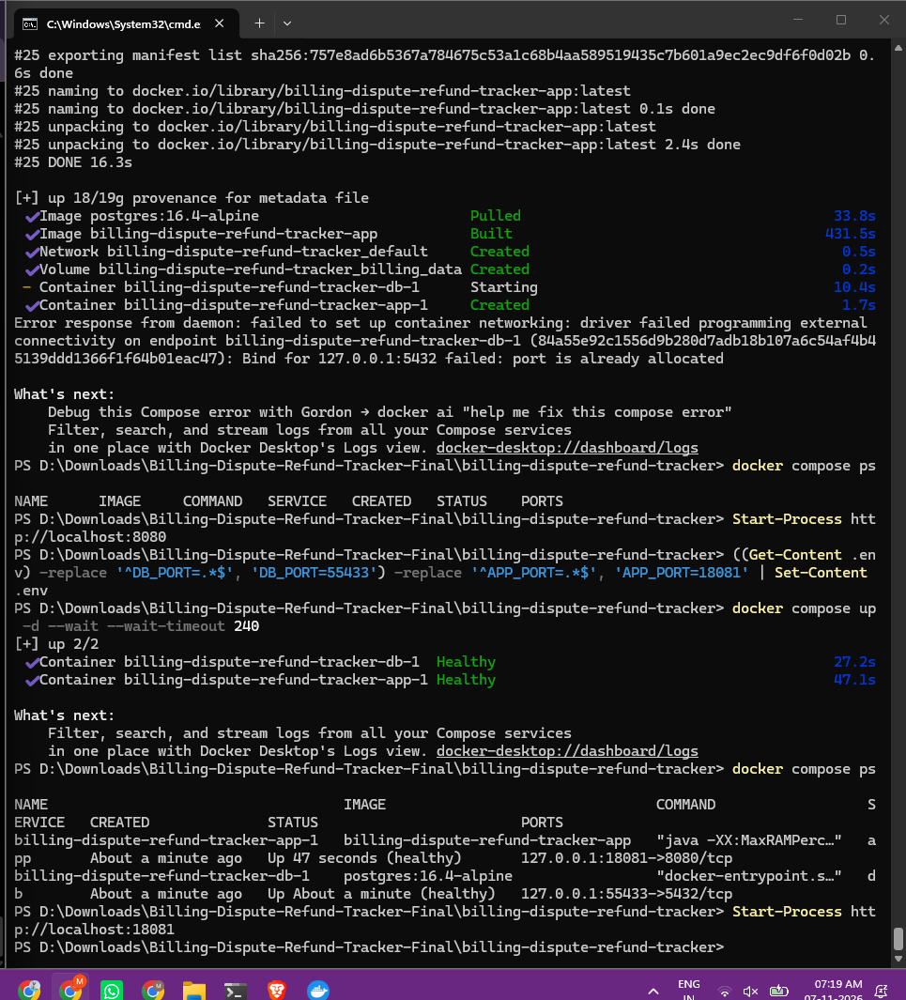

# Troubleshooting — Windows and Docker

[← README](../README.md) · [Verification record](LOCAL_VERIFICATION.md) · [User manual](USER_MANUAL.md)

These are issues that actually occurred during the Windows build, followed by a few common diagnostic cases. **All commands assume PowerShell at the repository root unless stated otherwise.**

## 1. Port 5432 is already allocated

**Symptom:** `Bind for 127.0.0.1:5432 failed: port is already allocated`. Another application has claimed the default PostgreSQL host port.

**Fix:** edit only this project's `.env`, not other Compose files:

```powershell
if (-not (Test-Path .env)) { Copy-Item .env.example .env }
(Get-Content .env) -replace '^DB_PORT=.*$', 'DB_PORT=55433' -replace '^APP_PORT=.*$', 'APP_PORT=18081' | Set-Content .env
docker compose up -d --wait --wait-timeout 240
docker compose ps
```

**Expected:** the `db` container is healthy on `127.0.0.1:55433`, the app is healthy on `127.0.0.1:18081`.



## 2. localhost:8080 opens EventPulse or another project

**Cause:** another local service already owns port 8080. The browser displays whatever is listening there; this does not mean Billing Tracker was deployed incorrectly.

**Fix:** `Start-Process http://localhost:18081` after setting `APP_PORT=18081` and recreating the app if needed. Do not stop other projects unnecessarily.

## 3. Unsigned PowerShell scripts are blocked

**Symptom:** `verify.ps1 cannot be loaded ... is not digitally signed`.

**Fix for a script you have inspected and trust:**

```powershell
powershell.exe -NoProfile -ExecutionPolicy Bypass -File ".\scripts\verify.ps1"
```

This does not permanently change your system's execution policy. It does **not** resolve missing tools such as Maven.

## 4. Maven command is not recognized

**Symptom:** `mvn : The term 'mvn' is not recognized`.

If your Maven 3.10.0 is extracted at the observed Windows location:

```powershell
$mavenBin = 'D:\Downloads\apache-maven-3.10.0-bin\apache-maven-3.10.0\bin'
Test-Path "$mavenBin\mvn.cmd"
$env:Path = "$mavenBin;$env:Path"
mvn -version
```

Expected: Maven prints its version **and Java 21**. Adjust the directory to your actual installation. Use the full JDK, not only a JRE.

## 5. Testcontainers cannot find Docker on Windows

**Symptom:** all 30 integration tests initially error with `Could not find a valid Docker environment` even though the application containers are already running. The issue is Testcontainers' Java-side Docker discovery, not necessarily Docker Desktop itself.

**Safe workaround used successfully:** create a dedicated disposable database, **not your normal application database**. Run from the project root:

```powershell
# Run only once; if the test container already exists, use: docker start billing-it-postgres
docker run -d --name billing-it-postgres -e POSTGRES_DB=billing_it -e POSTGRES_USER=billing_it -e POSTGRES_PASSWORD=local-only-test-pw -p 127.0.0.1:55434:5432 postgres:16.4-alpine
docker exec billing-it-postgres pg_isready -U billing_it -d billing_it
$env:TEST_DB_URL = 'jdbc:postgresql://127.0.0.1:55434/billing_it'
$env:TEST_DB_USER = 'billing_it'
$env:TEST_DB_PASSWORD = 'local-only-test-pw'
mvn -B -f backend/pom.xml clean verify
```

**Expected:** `WorkflowIT` shows 30 tests and zero failures/errors, then `BUILD SUCCESS`.

**Warning:** integration tests may reset dispute tables. Never point `TEST_DB_URL` at your live application DB (`55433`). Don't use `docker compose down -v` while preserving demo data.

## 6. Maven prints 'ERROR: injected audit failure' but succeeds

The code deliberately injects a database error in a rollback test. Check the final Maven summary. If it shows `Tests run: 30, Failures: 0, Errors: 0` and `BUILD SUCCESS`, the intentional failure was correctly handled.

## 7. Frontend npm audit reports four vulnerabilities

The local frontend originally used development/testing tools with four reported advisories (including two critical). A targeted upgrade was completed on 7 November 2026:

```powershell
Set-Location frontend
Copy-Item package.json package.json.backup -Force
Copy-Item package-lock.json package-lock.json.backup -Force
npm install --save-dev --save-exact vite@7.3.7 vitest@4.1.12
npm audit
npm run build
npm test
```

The observed audit reported **zero vulnerabilities**, and the build/eight tests passed. Do **not** run `npm audit fix --force` without reviewing the proposed changes. `.backup` files are local temporary backups and should not be committed to GitHub.

This documentation upgrade does not replace the updated `frontend` files. If you are reading from the original unmodified ZIP, you still need to apply and verify dependency fixes yourself.

## 8. Playwright cannot launch or download Chromium

From `e2e`:

```powershell
npm ci
npx playwright install chromium
$env:BASE_URL = 'http://127.0.0.1:18081'
npm test
```

Check the app in your browser first. If the suite cannot find `BASE_URL`, verify the exact port and make sure both Compose services are healthy. Do not point Playwright at another service on port 8080.

## 9. Unauthorized (401/403) or stale update (409)

- **401** — the session may be missing/expired. Sign in again.
- **403** — you may be using the wrong role or attempting a case not assigned to you. Never bypass server authorization checks.
- **409** — someone changed the dispute. Select **Reload dispute**, inspect the new version/status, then decide whether any action is still available.
- **CSRF validation failed** — refresh/sign in and retry through the UI; check that cookies are enabled and the API is accessed from the configured origin.

## 10. PostgreSQL or Flyway startup failures

```powershell
docker compose ps
docker compose logs --tail=80 db
docker compose logs --tail=120 app
```

Check that the database container is healthy, your `.env` variables are present, and port mappings don't conflict. Do not delete the volume to fix a mysterious migration problem without first backing up the data and reading the logs.

## 11. Frontend build or TypeScript failure

```powershell
Set-Location frontend
node --version
npm --version
npm ci
npm run build
npm test
```

If dependencies were upgraded, ensure `package.json` and `package-lock.json` belong to the same installation. Avoid manually editing `node_modules/`.

## 12. Git says 'not a git repository'

This happens when running `git status` before initialization. In the project root:

```powershell
git init -b main
git status
```

The screenshot from 7 November 2026 shows Git initialized successfully on `main` with **no commits yet**. Before your first commit, inspect `.gitignore` and the staged files: never publish `.env`, `node_modules`, real credentials or private customer data.

## 13. Checking your local services without deleting anything

```powershell
docker compose ps
docker compose logs --tail=40 app
docker compose logs --tail=40 db
```

Stopping Docker Desktop or closing a terminal does not delete the PostgreSQL volume, but it may stop the local application. To resume, restart Docker Desktop and run `docker compose up -d --wait` from the project root.
