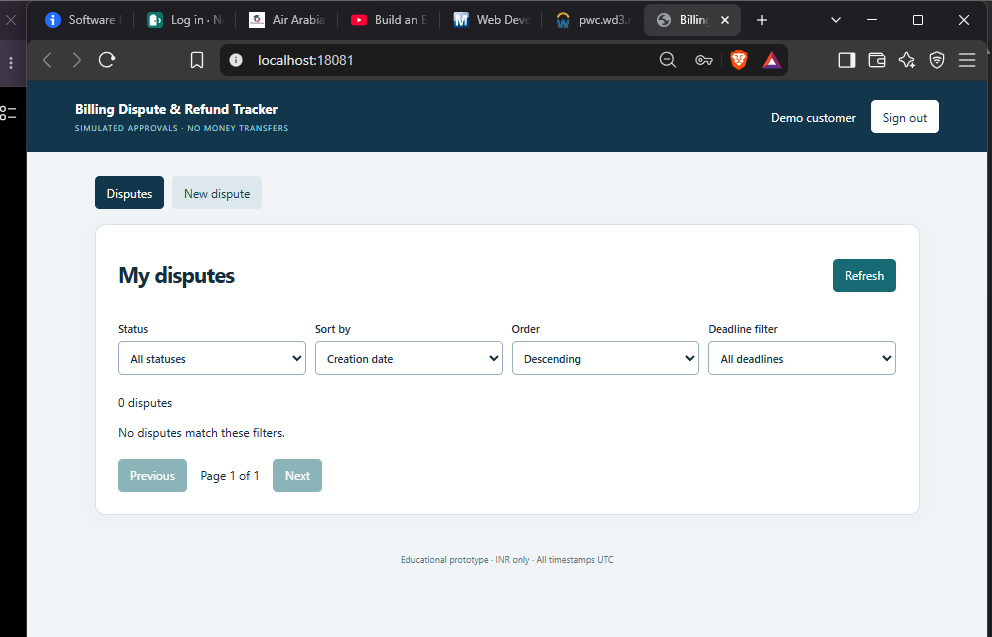
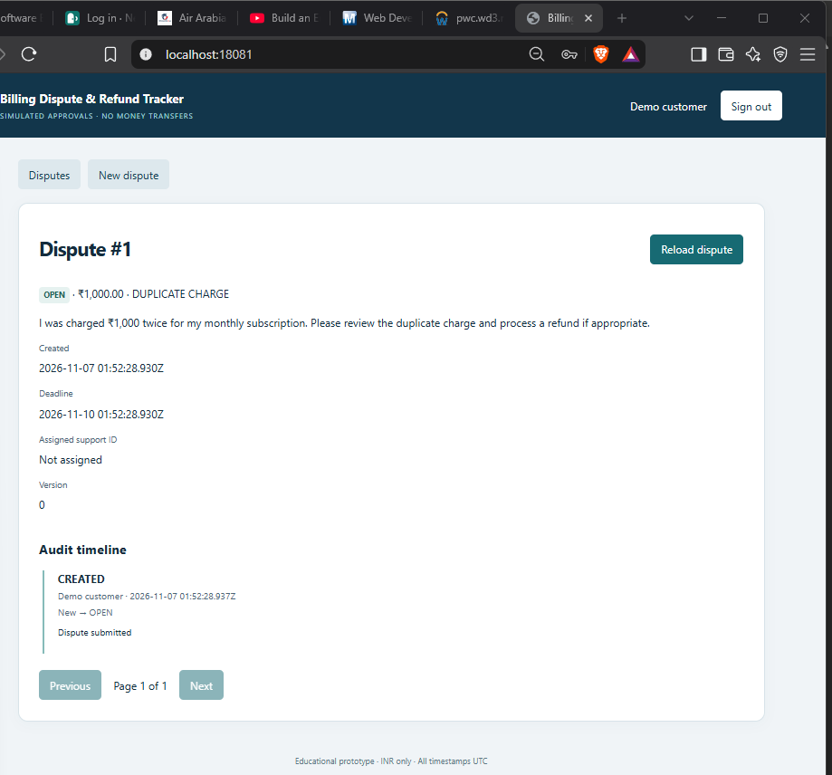
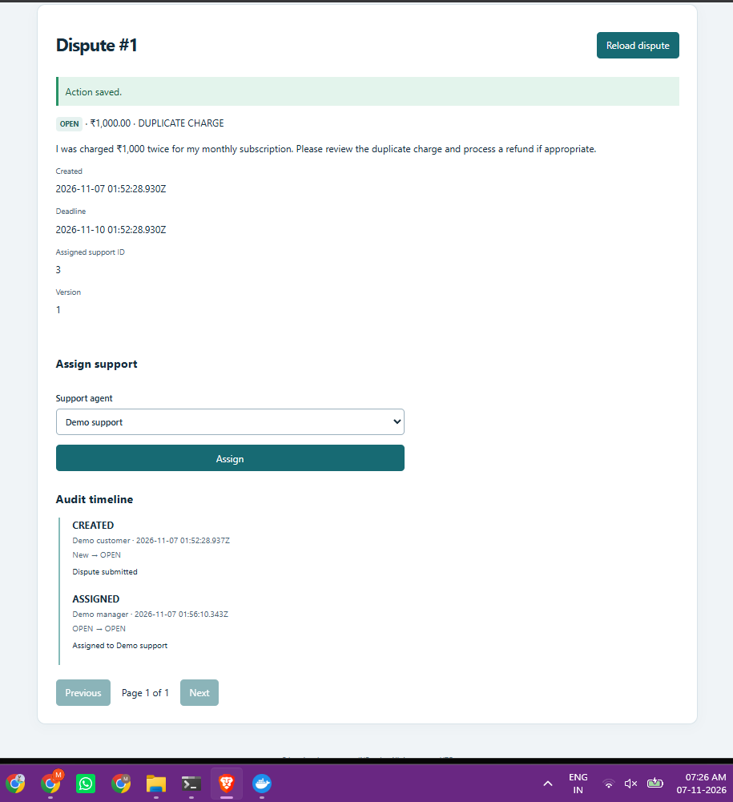
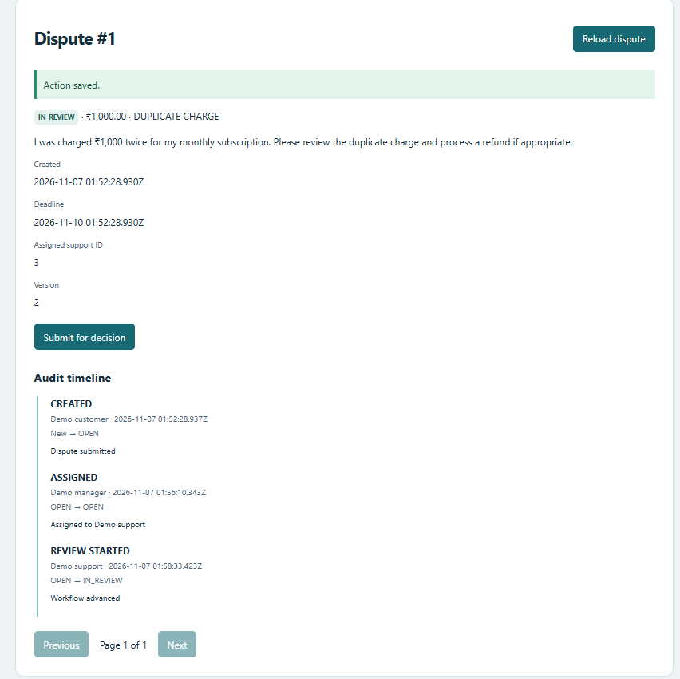
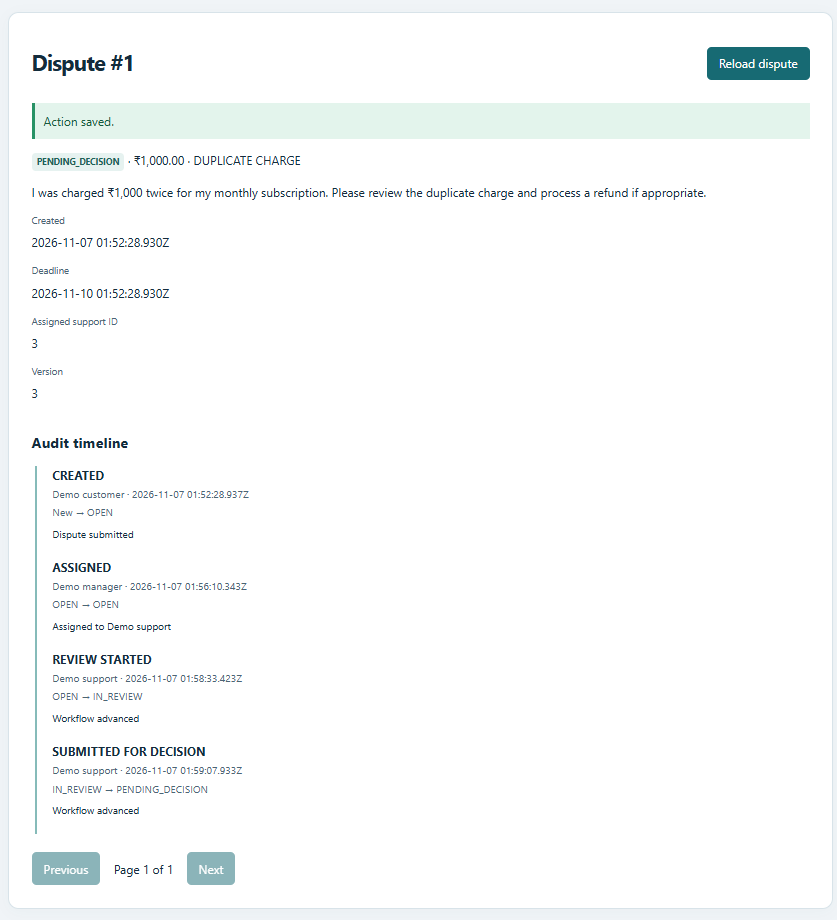
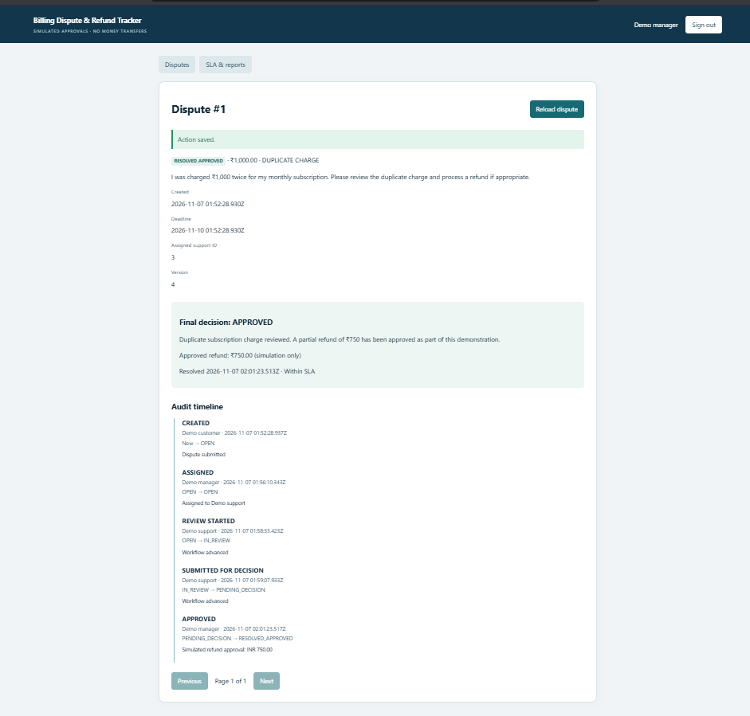
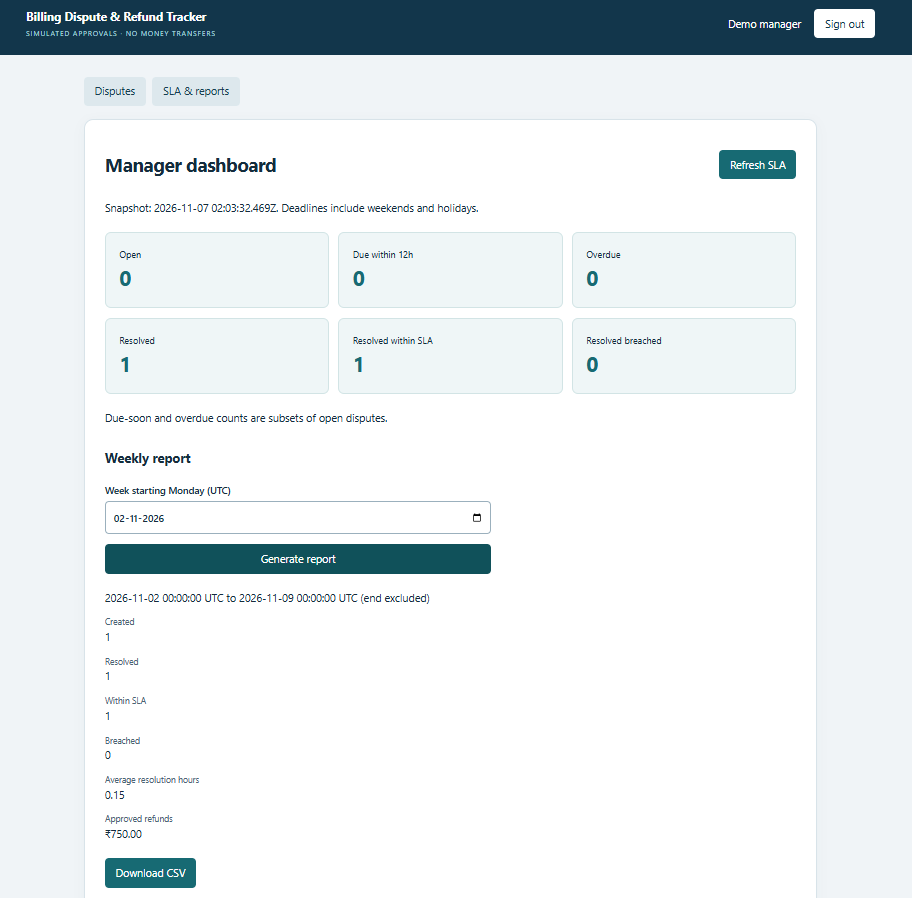

# User manual — Billing Dispute & Refund Tracker

[← README](../README.md) · [Screenshot gallery](SCREENSHOT_GALLERY.md) · [Troubleshooting](TROUBLESHOOTING.md)

## In one minute

This app lets a fictional customer challenge an incorrect charge. A manager assigns the case to support, support reviews it, and a manager records a final **simulated** approval or rejection. The app tracks who did what and whether the deadline was met. No real money is transferred.

### Before you begin

- Have the local application running (in the Windows demo: `http://localhost:18081`).
- Use only fictional information.
- Use the demo credentials below; do not reuse these passwords on public websites.

| Who are you? | Demo email | Demo password |
|---|---|---|
| Customer | `customer@demo.local` | `DemoPass123!` |
| Support agent | `support@demo.local` | `DemoPass123!` |
| Manager | `manager@demo.local` | `DemoPass123!` |

## 1. Customer — report a charge

1. Open the application and log in using the customer account.
2. Select **New dispute**.
3. Choose a category such as **DUPLICATE_CHARGE**.
4. Enter the amount and a clear description (at least ten characters). Example: *I was charged INR 1,000 twice for my subscription. Please review the duplicate charge.*
5. Select **Submit dispute**.
6. On the new dispute page, note its ID, status **OPEN**, deadline and initial **CREATED** history entry.
7. Use **Disputes** to view your own cases. Filters and pagination help find older records.

| New customer's queue | Submitted dispute |
|:--:|:--:|
|  |  |

The application uses a deadline exactly **72 elapsed hours after submission**, including weekends and holidays. The displayed times use UTC, not local Indian time.

## 2. Manager — assign the case

1. Select **Sign out**.
2. Log in as `manager@demo.local`.
3. Select **Disputes**, then click the dispute number (for example, **#1**).
4. In **Assign support**, choose **Demo support** and select **Assign**.
5. Confirm the assigned support ID appears and the **ASSIGNED** audit event is recorded. The case is still **OPEN**.

## 3. Support — review the case

1. Sign out and log in as `support@demo.local`.
2. Open the assigned case from **Support queue**.
3. Select **Start review**. The status changes to **IN_REVIEW**.
4. After reviewing the fictional description, select **Submit for decision**. The status changes to **PENDING_DECISION**.
5. Read the new audit entries to confirm each action was recorded.

| Review started | Awaiting manager decision |
|:--:|:--:|
|  |  |

## 4. Manager — record a final decision

1. Sign out and return as manager.
2. Open the case marked **PENDING_DECISION**.
3. Choose **APPROVED** or **REJECTED**.
4. For approval, enter a simulated refund between INR 0 and the disputed amount. For rejection, the recorded refund is zero.
5. Enter a meaningful explanation of at least ten characters.
6. Select **Save final decision**. This cannot be changed afterward.
7. Check the final decision panel and the **APPROVED/REJECTED** audit entry.

**Important:** The approval only records a decision. It does not send money to a bank account, card or payment system.

## 5. Manager — see SLA and weekly reporting

1. Select **SLA & reports**.
2. Read the summary tiles: Open, Due within 12h, Overdue, Resolved, Resolved within SLA, Resolved breached.
3. Under **Weekly report**, select a Monday in UTC. For the demonstrated case, choose **2 November 2026**.
4. Select **Generate report**.
5. Review how many cases were created and resolved, the SLA outcomes, average resolution time and simulated refund total.
6. Select **Download CSV** to open the report in spreadsheet software.

The demonstration report showed **one resolved case, within SLA, with INR 750 simulated approval** and about nine minutes of resolution time. These are **one fictional example**, not customer-service performance statistics.

## What the statuses mean

| Status | Meaning | Who takes the next action? |
|---|---|---|
| `OPEN` | Received and waiting for review. | Manager assigns; assigned support starts review. |
| `IN_REVIEW` | The assigned support agent is examining it. | Support submits for decision. |
| `PENDING_DECISION` | Ready for final manager review. | Manager approves or rejects. |
| `RESOLVED_APPROVED` | A simulated refund amount was approved. | No further changes. |
| `RESOLVED_REJECTED` | Refund request was rejected with explanation. | No further changes. |

## Common questions

**Why can't I see another customer's dispute?** The backend limits customers to their own records. This is intentional access control.

**Why do I get a conflict message?** Someone changed the case after you opened it. Select **Reload dispute** and review the current status before trying again.

**Can I undo a final decision?** Not in this educational version. The database protects the one-decision rule.

**Why is a date different from my local time?** All application timestamps use UTC. India is UTC+05:30.

**Why does the dashboard show more disputes than this manual?** Browser tests and screenshot automation may create additional synthetic records. The counts come from the current local database.

**Why is the app unavailable?** Ask the demonstrator to check Docker containers and the configured host port. See [troubleshooting](TROUBLESHOOTING.md).
